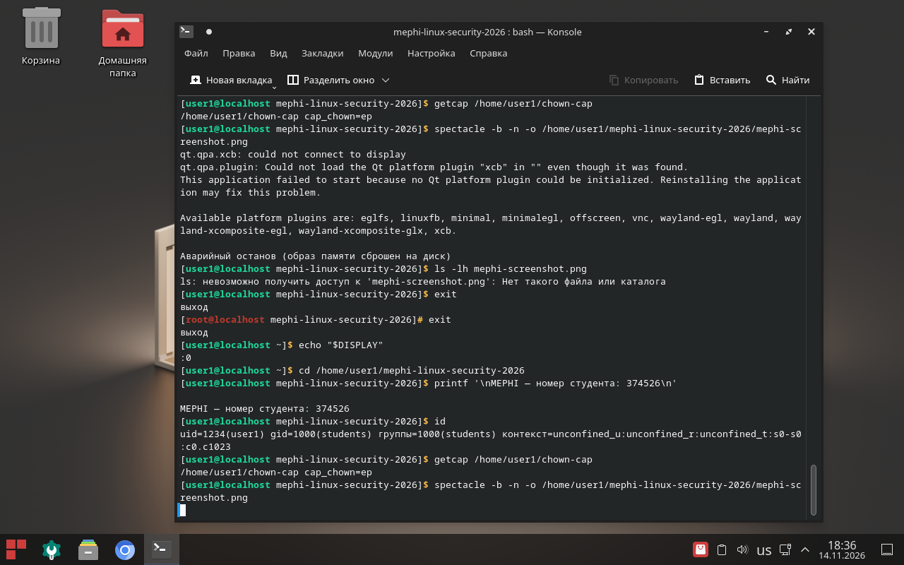

# 🔐 Безопасность Linux — МИФИ

Практическая работа по управлению пользователями и привилегиями в **РЕД ОС**.

**Номер студента:** 374526  
**GitHub:** [prishel2025](https://github.com/prishel2025)

## 📋 Результаты выполнения

| Раздел | Что сделано | Результат |
| :--- | :--- | :---: |
| 1. Пользователь | user1, UID 1234, группа students | ✅ |
| 1. Пароль | Смена пароля каждые 90 дней | ✅ |
| 2. Файлы | Найдены файлы с битом set-UID | ✅ |
| 2. Процессы | Найдены процессы с RUID 1234 и EUID 0 | ✅ |
| 3. set-UID | Копия cat прочитала защищённый файл | ✅ |
| 4. Capabilities | Копия chown изменила владельца файла на root | ✅ |
| 5. sudo | Пользователю user1 разрешён запуск date от root | ✅ |

## 🛡️ Проверка механизмов привилегий

### set-UID

Утилита скопирована в `/home/user1/cat-suid`.

- Без set-UID чтение `/root/setuid-demo.txt` завершилось отказом.
- После назначения владельца root и прав 4755 файл успешно прочитан.
- После сохранения результатов set-UID снят.
- В `stat.out` сохранены права на момент демонстрации.

### Linux capabilities

Утилита скопирована в `/home/user1/chown-cap`.

- Без capability изменение владельца на root завершилось отказом.
- После назначения `cap_chown=ep` операция выполнена успешно.

### sudo

В sudoers добавлено правило:

`user1 ALL=(root) /usr/bin/date`

Конфигурация проверена через `visudo -c`. Пользователь user1 успешно выполнил `sudo /usr/bin/date`.

## 📸 Подтверждение выполнения

## 📁 Артефакты

| Файл | Содержимое |
| :--- | :--- |
| [history.out](history.out) | История команд |
| [history-root-final.out](history-root-final.out) | Дополнительная история root |
| [stat.out](stat.out) | Права домашней папки и утилит |
| [getcap.out](getcap.out) | Назначенные capabilities |
| [files-suid.out](files-suid.out) | Поиск файлов с set-UID |
| [processes.out](processes.out) | Мониторинг процессов |
| [passwd](passwd) | Учётные записи пользователей |
| [group](group) | Группы |
| [shadow](shadow) | Копия с замаскированными полями паролей |
| [sudoers](sudoers) | Настройки sudo |

> Поля паролей в копии shadow заменены на REDACTED. Исходные хеши паролей не опубликованы.
